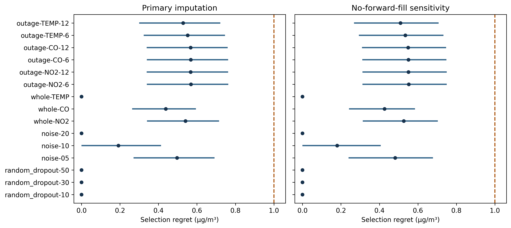
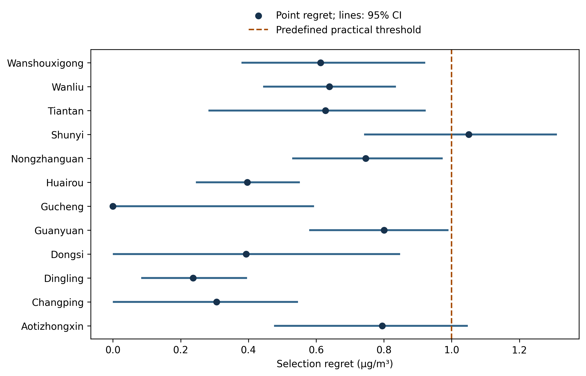

# AirSense-R: Do Air-Quality Forecasters Keep Their Rank Under Sensor Degradation and Site Shift?

Oyewale Daniel Oyewola

**Editorial status:** the actively edited submission draft is `paper/overleaf/main.tex`.
This Markdown manuscript is retained as the accepted-evidence narrative; it is
not a second submission draft. Title and publication-name differences remain
subject to author confirmation before repository metadata is synchronized.

**First complete manuscript draft — 22 October 2026.** Based on accepted P5–P8 results. Author affiliation, correspondence, funding, competing-interest and contribution statements require author confirmation before submission. This draft has not been submitted or peer reviewed.

**Checkpoint update — 30 October 2026:** the bounded post-results target-history extension is independently verified and accepted. Its findings are reported separately from the original confirmatory results, alongside tolerance sensitivity and focused prior-work positioning.

## Abstract

Selecting an air-quality forecaster from clean validation accuracy does not establish whether that choice remains competitive when observations deteriorate or the monitoring site changes. We evaluate the reliability of this selection decision for one-hour-ahead PM2.5 forecasting using hourly observations from 12 Beijing stations. Persistence, XGBoost, a multilayer perceptron and a compact gated recurrent unit network were compared under a frozen chronological protocol with training-only tuning, a predefined 1 µg/m³ practical near-tie rule and paired temporal-block uncertainty. Primary synthetic interventions covered random non-target feature dropout, channel loss, measurement noise and contiguous outages; historical PM2.5 was not synthetically corrupted. Site shift was evaluated through 12 leave-one-station-out folds with fold-specific fitting and selection. Although XGBoost had the lowest clean-test MAE (9.711 µg/m³), the validation rule selected persistence, whose clean-test regret was 0.569 µg/m³ (95% CI 0.340–0.763). Persistence remained within the practical threshold in all 15 full-period stress conditions under each imputation policy. Mean station-specific regret under site holdout was 0.550 µg/m³ (95% CI 0.400–0.739), with 11 of 12 station point estimates within the practical threshold. Numerical rank changes therefore did not generally imply a large penalty for retaining the selected model. A separately declared post-results extension, however, found that 12-hour PM2.5 outages raised regret to 2.282 (95% CI 1.696–2.910) in affected-history windows, despite full-period regret of 0.651. These findings support a bounded conclusion about selection reliability that depends on target-history availability and the evaluation window, rather than universal persistence superiority, robustness to physical sensor failure, or inter-city transfer.

**Keywords:** PM2.5 forecasting; model selection; selection regret; missing observations; temporal bootstrap; unseen-station generalization.

## 1. Introduction

An air-quality forecasting comparison ultimately supports a choice: which system should be used for the next forecast? A model ranking provides only part of that answer. Two models can exchange places while differing negligibly in error, and a model with low average error can incur substantial excess error in a particular deployment condition. Evaluating the selection decision requires both the magnitude of the resulting error and the uncertainty in comparisons with alternatives.

This distinction motivates AirSense-R. The study asks whether a family selected from clean validation remains practically competitive when non-target observations are degraded or a monitoring station is excluded from fitting. Here, *clean* means no added synthetic intervention; naturally missing measurements remain. *Sensor degradation* denotes controlled input interventions, and *site shift* denotes within-Beijing unseen-station generalization with local historical measurements available at inference.

The research problem is not important merely because its application concerns air quality. It matters because selection based on validation data is a decision rule whose consequences can be tested under specified changes in observation conditions. A useful result can identify fragile selection, or show that the rule remains competitive despite changes in numerical ranking. Neither outcome is assumed in advance.

The contributions are an empirical evaluation of a frozen selection rule across complementary stresses; paired comparison of selection regret, ranks and practical near-ties; and a versioned evidence chain connecting configurations, predictions, native model identities and independent verification. We introduce no new forecasting architecture and make no claim that missing-data forecasting, spatial generalization or ML-versus-deep-learning comparison is novel. The inference is limited to the declared candidates, dataset, horizon and interventions.

## 2. Related work

Missing observations and spatial generalization already appear together in air-quality research. Alvarado-Alcon et al. investigate forecasting over sparse sensor networks, cross-location prediction and deep-learning behavior under missing data. Their setting and architecture comparisons overlap directly with the motivation for this study; they preclude presenting missingness or held-out locations alone as a new contribution. [Alvarado-Alcon et al. (2026)](https://doi.org/10.3390/jsan15040052).

Imputation is also part of the forecasting system rather than a neutral preparation step. Chowdhury et al. examine PM2.5 prediction under alternative imputation strategies for incomplete sensor data. This motivates our common preprocessing policy and predefined no-forward-fill sensitivity, while our primary endpoint concerns the retained model-selection decision. [Chowdhury et al. (2026)](https://www.nature.com/articles/s41598-026-55848-4).

Distribution-shift evaluation is established prior art. Liu et al. compare graph-based and non-graph-based PM2.5 forecasting under different temporal splits and report differing sensitivity to shift. Their study concerns graph learning and temporal distribution shift; our site-holdout experiment uses local station histories and repeats model selection after excluding each station. [Liu et al. (2024)](https://experts.illinois.edu/en/publications/pm25-forecasting-under-distribution-shift-a-graph-learning-approa/).

Semper et al. address robust post-training selection by reevaluating fixed predictions against perturbed evaluation references, with selection regret and validation-based rule comparison; their study includes PM2.5 data. AirSense-R instead intervenes on input observations and generates corresponding forecasts, alongside station exclusion. This distinction supports cautious empirical positioning, not a claim to invent selection regret. A full-text comparison and broader citation review remain necessary. [Semper et al. (2026)](https://doi.org/10.1016/j.knosys.2026.116673).

AirSense-R's narrower emphasis is the excess forecasting error incurred by retaining a predefined clean-validation choice. Its contribution is not established by the absence of an identical title in prior literature. The [focused positioning audit](../research/P9_POSITIONING_REVIEW.md) distinguishes verified source material from remaining full-text checks. The work is positioned as a reproducible empirical study of selection reliability.

## 3. Data and forecasting task

We use the UCI Beijing Multi-Site Air Quality dataset, a multivariate hourly environmental time series. No images, satellite products or computer-vision inputs are used. The data source is UCI rather than Kaggle. [UCI dataset record](https://doi.org/10.24432/C5RK5G).

The repository's structural audit verified 420,768 rows across 12 stations, with 35,064 hourly rows per station and no duplicate timestamps or gaps in the timestamp grid. Missing measurements do occur: the audit records 8,739 missing PM2.5 values (2.08%) and 20,701 missing CO values (4.92%). A complete timestamp grid therefore does not imply complete sensor observations. The archive is identified by SHA-256 `b04da438b2f331ac0ffd45aebdfec0d20d2367feb5f6948c4b1f7ce1191e33c4`.

The target is PM2.5 concentration one hour ahead, using the preceding 24 chronological hourly feature vectors. Numeric channels are PM2.5, PM10, SO2, NO2, CO, O3, temperature, pressure, dew point, rainfall and wind speed. Wind direction is categorical. Deterministic sine/cosine features represent hour of day and day of year at the target timestamp. Station identity is used for grouping and exclusion, not as a predictor.

Targets remain the original observed PM2.5 measurements: missing targets are not imputed or scored, and synthetic interventions never change labels. Eligibility requires the chronological input window and an observed target, not complete raw input measurements. The accepted clean test contains 102,753 distinct station-target observations shared across candidates. Reported model/seed rows are not independent samples.

## 4. Methods

### 4.1 Causal preprocessing

Each raw channel has a missingness indicator. Within a station, earlier observations are carried forward for at most six consecutive hours. Remaining numeric gaps use medians estimated from fitting data only. Wind direction uses training-derived one-hot categories, with dedicated missing and unseen-category representations. MLP/GRU numeric inputs are standardized using training-derived means and population standard deviations after imputation; indicators and one-hot values are not standardized. XGBoost receives unscaled numeric inputs. Targets remain in original units.

The sensitivity policy removes forward fill while preserving training-only fallback and missingness indicators. It is applied at inference to the frozen models; it is not a separately retrained, fully adapted alternative pipeline. Persistence predicts the last input PM2.5 after the applicable preprocessing policy. Hence its predictions may differ between imputation policies even though non-target synthetic interventions do not change them within a policy.

### 4.2 Candidate families and bounded tuning

Persistence provides an untuned baseline. XGBoost uses histogram-based boosted regression trees; this is a standard tree-boosting framework rather than a newly proposed method. [Chen and Guestrin (2016)](https://arxiv.org/abs/1603.02754). The MLP flattens the 24-hour history and appends calendar features. The GRU encodes the sequential history and combines its output with calendar features through a dense head. GRUs are gated recurrent neural networks; their use here does not involve image processing. [Cho et al. (2014)](https://aclanthology.org/D14-1179/).

| Family | Declared alternatives | Fixed fitting settings |
|---|---|---|
| XGBoost | Maximum depth 3 or 6 | 200 rounds; learning rate 0.05; squared-error objective; histogram bins 256; full row/column sampling |
| MLP | Hidden widths [64, 32] or [128, 64] | ReLU hidden layers; linear output; Adam at 0.001; 20 epochs |
| GRU | 32 or 64 recurrent units; dense head of 16 | ReLU head; linear output; Adam at 0.001; 20 epochs |

Neural training uses mean squared error and batches of 512, without early stopping, target scaling or prediction clipping. Training seeds are 42, 31415 and 27182. Persistence is not artificially replicated. Three expanding temporal folds within the training period determine the configuration with lowest mean fold MAE; listed candidate order resolves configuration ties. Selected configurations are refit on the full permitted training data. The search budget deliberately tests compact implementations and does not support a claim about the best achievable performance of each architecture.

### 4.3 Selection rule and regret

Let \(L_{s,m}\) denote the MAE of family \(m\) in condition \(s\), computed by averaging seed-specific metrics within station and then weighting stations equally. Clean-validation scores determine one family before final evaluation. Candidates within \(\delta=1.0\) µg/m³ of the lowest validation MAE are resolved by the fixed simplicity order: persistence, XGBoost, MLP, GRU. Thus the selected family need not be the exact numerical validation winner.

For selected family \(\hat m\), retrospective selection regret is

\[
R_s=L_{s,\hat m}-\min_{m\in\mathcal M} L_{s,m}.
\]

The minimum is a test-set oracle among the declared candidates, not an operational selection rule. Under site holdout, selection differs by fold in principle; aggregate regret is the mean of station-specific regrets. It is not obtained by subtracting the best fixed-family aggregate MAE from the selected-policy aggregate MAE.

We also report RMSE, station-averaged R², numerical ranks, Kendall's tau-b, winner retention and relative performance degradation, \(100(L_s-L_{clean})/L_{clean}\). RPD accompanies absolute error. A practical near-tie is a predefined descriptive threshold, not a formal statistical equivalence result.

## 5. Experimental protocol and uncertainty

### 5.1 Time and station isolation

All boundaries use target timestamps:

| Partition | Start | End |
|---|---|---|
| Training | 2013-03-02 00:00 | 2015-02-28 23:00 |
| Validation | 2015-03-01 00:00 | 2016-02-29 23:00 |
| Test | 2016-03-01 00:00 | 2017-02-28 23:00 |

Internal training folds end fitting on 28 February, 30 June and 31 October 2014; their validation periods cover the following four months, ending February 2015. Preprocessing is refitted within each internal fold. A forecast may use observations from a preceding partition when they occur before its target; learned preprocessing never uses later partitions.

For each of 12 leave-one-station-out folds, the held-out station is excluded from preprocessing fitting, tuning, training and validation family selection. The remaining stations obey the same time boundaries. All fold selections are frozen before final test access. At inference, the held-out station's recent measurements are available. This evaluates forecasting at an unseen station with local history, not spatial interpolation into an uninstrumented location. The 12-fold experiment completed 756 learned-model fits.

### 5.2 Observation interventions

Models and learned preprocessing parameters are frozen during sensor-degradation evaluation. Interventions modify the underlying chronological input stream before overlapping windows are formed, so repeated appearances of an observation receive the same modification. Candidate models share corruption realizations and eligible targets.

| Intervention | Frozen settings |
|---|---|
| Random dropout | Independent masking at 10%, 30%, 50% on non-target channels, including wind direction |
| Whole-channel loss | NO2, CO or temperature, one channel per condition |
| Measurement noise | Gaussian noise with SD 5%, 10%, 20% of training IQR/1.349; training SD fallback when IQR is zero |
| Contiguous outage | NO2, CO or temperature; 6 or 12 hours; one start per calendar month/station/realization |

Noise excludes categorical wind direction and is clipped at zero for naturally nonnegative channels. Historical PM2.5 is excluded from all declared synthetic interventions. The five corruption seeds are 101, 202, 303, 404 and 505; deterministic whole-channel loss has one realization. This gives 15 conditions and 63 realizations per policy. Outages have both full-period and affected-window summaries; their latter targets have input histories intersecting the outage.

### 5.3 Dependence-aware uncertainty

The frozen bootstrap uses 2,000 paired moving-block replicates, 24-hour blocks, 95% percentile intervals and seed 424242. Temporal resampling retains calendar-hour positions, including masks for missing target observations, rather than treating the compressed sequence of available rows as contiguous time. Shared temporal draws preserve pairing across candidates. Metrics average over the fitted training and corruption seed sets before the relevant station aggregation. Regret is recomputed against the candidate minimum within each replicate.

Block resampling addresses dependence more directly than treating individual hours as independent observations; the general methodological basis is Künsch's work on resampling stationary sequences. [Künsch (1989)](https://doi.org/10.1214/aos/1176347265). The fixed block length does not guarantee adequate treatment of every dependence scale or nonstationarity. Intervals are conditional on the fitted seeds, observed stations and period, and are pointwise rather than simultaneous across all conditions. Sparse affected-window estimates with an empty bootstrap station/realization are reported as unavailable rather than repaired by redrawing.

### 5.4 Verification and post-results disclosure

The protocol was frozen before final evaluation; implementation decisions and later corrections are versioned. During clean-test recovery, serialized preprocessing mappings reordered scaled input columns. Corrected scoring reused the original models and selection after development replay. A separate exact CSV parsing correction preserved decimal target values. Original invalidated outputs remain archived, and only the accepted corrected evaluation is used here. Neither correction involved retuning or relaxing replay tolerances.

Independent verification checked prediction-file checksums, model lineage, metrics and calendar-block uncertainty. P7 verification covered 720 prediction CSVs and 108 final native models; P6 verification covered 1,281 target/prediction bundles. P8 concentration bands, seasonal summaries and worst-error listings were specified after aggregate results became available. They are explicitly exploratory, not additional preregistered hypotheses.

## 6. Results

### 6.1 Clean benchmark and unseen-station performance

| Family | Clean MAE | Clean RMSE | Clean R² | LOSO MAE | LOSO RMSE | LOSO R² |
|---|---:|---:|---:|---:|---:|---:|
| XGBoost | 9.7109 | 18.9209 | 0.9466 | 9.7492 | 19.0915 | 0.9456 |
| Persistence | 10.2796 | 19.6549 | 0.9422 | 10.2797 | 19.6549 | 0.9422 |
| MLP | 10.8102 | 18.9385 | 0.9463 | 10.9470 | 19.1289 | 0.9451 |
| GRU | 15.9574 | 37.1660 | 0.6884 | 10.3019 | 19.4106 | 0.9408 |

**Table 1.** Accepted clean and LOSO metrics. MAE/RMSE are µg/m³. R² is averaged across station/seed metrics, not calculated from pooled targets. LOSO refits and selects within every fold, so differences between the two sets of columns are not causal estimates of a site-shift penalty or benefit.

XGBoost has the lowest clean-test MAE. Nevertheless, the validation rule selected persistence through the predefined near-tie/simplicity rule. Clean-test regret is 0.5688 µg/m³, with 95% CI [0.3400, 0.7632]. The numerical advantage of XGBoost is resolved under this bootstrap, but its magnitude remains below the practical threshold. The GRU result demonstrates poor performance of this fitted, bounded-budget implementation; it does not establish a general disadvantage of recurrent forecasting.

### 6.2 Sensor-degradation results

Persistence remains within the practical threshold in all 15 full-period conditions under each policy, and is numerically best in five conditions per policy. Maximum full-period regret is 0.5686 µg/m³ for primary imputation and 0.5520 for no-forward-fill. The greatest upper endpoint among these full-period regret intervals is 0.7631 µg/m³. This comparison of endpoints is descriptive and does not imply simultaneous 95% coverage.

**Figure 1.** Full-period selection regret for each declared sensor condition under primary and sensitivity preprocessing. Points are estimates; horizontal segments are paired 95% bootstrap intervals. The dashed line marks the fixed 1 µg/m³ threshold. Zero-width intervals arise when persistence remains the candidate minimum in the sampled comparisons; they do not establish universal superiority. Historical PM2.5 is uncorrupted by design. Supplementary Table S3 reports all 42 full-period/affected-window summaries.

Numerical rankings are not invariant: primary full-period Kendall tau-b ranges from 1/3 to 1 across conditions. Persistence predictions remain unchanged within each imputation policy because their required target-history channel is not synthetically altered. Thus this result tests whether additional non-target observations cause the selected simple model to become practically inferior to the alternatives. It is not a demonstration that persistence withstands failure of its own required sensor history.

The six affected-window outage summaries under each policy also place persistence within the practical threshold by point estimate; their largest point regret is approximately 0.5700 µg/m³. All twelve affected-window intervals were available. Supplementary Tables S3 and S6 retain those scopes separately, including matched-clean errors, RPD, ranks and paired selected-minus-comparator intervals for every model. Full-period outage averages should not be substituted for affected-window performance.

### 6.3 Fold-specific selection under site holdout

The near-tie rule selects persistence in all 12 folds. Its mean station-specific regret is 0.5504 µg/m³ (95% CI [0.4004, 0.7388]). Eleven station point estimates fall within the practical threshold, although persistence is the exact numerical test winner only at Gucheng. Kendall tau-b between each fold's validation and held-out test rankings ranges from 1/3 to 1. These results distinguish stable practical selection from exact winner retention.

**Figure 2.** Station-specific regret of the frozen validation choice against the within-station candidate oracle. Intervals use paired calendar-block resampling and are conditional on the observed station and fitted seeds. The practical threshold is not a null-hypothesis test.

Shunyi has the largest point regret, 1.0504 µg/m³, with interval [0.7417, 1.3109]. The interval excludes zero but crosses 1 µg/m³: there is evidence of positive excess error, while its magnitude relative to the practical threshold remains uncertain. Aggregate fixed-family XGBoost MAE is 9.7492 compared with persistence's 10.2797; that difference is not the mean station-oracle regret because the oracle can vary across stations.

### 6.4 Exploratory error regimes and cases

In P7's target-concentration bands below 200 µg/m³, XGBoost has the lowest descriptive MAE. In the ≥200 band, persistence has the lowest MAE: 22.59 versus XGBoost's 25.42 µg/m³. All bands contain observations at all 12 stations; the ≥200 band contains 8,782 distinct station-target observations. These summaries are post-results diagnostics without subgroup confidence intervals and do not establish confirmatory subgroup superiority. Concentration bands are not AQI or health categories.

The largest exported P7 absolute error occurs at Wanshouxigong on 4 January 2017 at 13:00: the observed target is 3 µg/m³ and the persistence forecast is 621 µg/m³. The resulting error is 618 µg/m³. This flags a case for contextual examination but does not identify its physical cause or prove sensor malfunction. The observation was retained; no post hoc deletion or retuning was performed. Low aggregate selection regret can coexist with severe individual forecast errors.

### 6.5 Post-results practical-tolerance sensitivity

After the primary results were accepted, we examined tolerances of 0.5, 1.0, 1.5 and 2.0 µg/m³ in two separate descriptive analyses. The original 1.0 rule remains primary. First, retaining the original selections, the numbers of LOSO station point regrets within tolerance were 5/12, 11/12, 12/12 and 12/12 respectively. For full-period auxiliary stress, corresponding counts were 8/15, 15/15, 15/15 and 15/15 under each policy. Clean regret exceeds 0.5 by point estimate, but its interval crosses that tolerance. These counts do not establish statistical equivalence.

Second, applying each tolerance to saved validation scores alone retained persistence in the pooled clean benchmark at all four values. At 0.5, one LOSO fold, Nongzhanguan, instead selected XGBoost; the resulting mean station-specific test regret was 0.4978, compared with 0.5504 under the original rule. No new intervals were computed for that counterfactual policy. The selection decision was largely stable over this range, whereas its practical interpretation depended on tolerance. No threshold was chosen from test results. Separate tables and provenance are available in the [threshold audit](../research/P9_THRESHOLD_REVIEW.md).

### 6.6 Post-results PM2.5 target-history degradation

The bounded extension declared on 29 October 2026 used the accepted frozen P5 models and original validation-selected persistence family. It masked PM2.5 input history at 10%, 30% and 50%, or imposed 6/12-hour outages, with the original five corruption seeds and primary causal imputation. Future labels remained unchanged, all models shared the same corrupted streams, and no fitting or reselection occurred. This is post-results sensitivity evidence, not an addition to the original confirmatory protocol. Final saved arrays were independently checked in Colab: 261 bundle checksums, all seed-level metrics, and paired 24-hour bootstrap intervals agreed with the original reports.

| PM2.5 intervention | Full-period selection regret | Outage-affected selection regret |
|---|---:|---:|
| Dropout 10% | 0.000 | — |
| Dropout 30% | 0.000 | — |
| Dropout 50% | 0.000 | — |
| Outage 6 hours | 0.557 | 0.198 |
| Outage 12 hours | 0.651 | 2.282 |

All regrets are in µg/m³. Full-period regret remains below the original practical threshold, but averaging over the full period conceals a conditional loss. In windows whose input history intersects a 12-hour outage, persistence MAE is 21.306 versus XGBoost's 19.024 µg/m³; selection regret is 2.282 (95% CI 1.696–2.910), entirely above 1 µg/m³. For 6-hour outage-affected windows, regret is 0.198 (95% CI 0.000–0.781). These scopes include affected input histories, not only times at which a sensor is missing.

Persistence has the lowest full-period MAE among the four candidates under each random-dropout condition. Nevertheless, its MAE rises to 15.671 µg/m³ at 50% dropout, compared with 10.280 clean. Low selection regret therefore does not imply low absolute error or validate a fallback policy. Complete model comparisons are in Supplementary Table S7; the [acceptance record](../results/p9-target-history/final_acceptance.json) distinguishes live saved-array verification from local review of its reports.

## 7. Discussion

The principal result is practical competitiveness of a simple validation-selected rule despite imperfect retention of numerical ranking. It does not require every candidate to maintain its position. The distinction is clearest under site holdout: persistence is numerically best at only one station, yet its point regret is within the predefined practical threshold at eleven. A narrative based solely on winner retention would obscure that magnitude distinction.

The result also depends on the selection rule. Persistence was selected through an explicit simplicity preference among near-ties, not because it minimized validation error everywhere. Consequently, AirSense-R evaluates an accuracy-and-simplicity decision rule. The post-results tolerance audit illustrates dependence on the practical criterion without replacing it. Other cost functions and adaptive selection policies remain untested. Selection regret evaluates model-choice cost relative to available alternatives; it does not establish absolute forecasting adequacy. High regret alone does not validate a switching or fallback policy.

The protected target history is central to interpreting the primary experiment. A one-hour persistence forecast can remain informative while other channels deteriorate. Its unchanged forecasts under within-policy non-target stress are a designed property, whereas its competitiveness relative to the learned models is the empirical outcome. The separate target-history extension identifies a boundary: full-period practical competitiveness coexists with regret above the predefined threshold in 12-hour outage-affected windows. Reporting only annual averages would obscure that loss. This does not establish a validated rule for switching models during outages; such a policy would require prospective specification and evaluation.

The contrast between pooled and LOSO GRU results should not be interpreted as a benefit of holding out a station. Different fitted models and fold-specific configuration choices are involved. Establishing why a particular fit behaves poorly would require separate, training-data-based diagnostic work; it cannot be inferred from aggregate test metrics. The present evidence supports conclusions about these instantiated pipelines rather than an architecture hierarchy.

In relation to the frozen hypotheses, clean-test results support a numerical learned-model advantage over persistence for XGBoost. Numerical ranks change under some stresses, while practical near-ties frequently explain their limited decision consequence. Station-specific regret varies. The general hypothesis of worsening error with corruption severity is not treated as universally confirmed: intervention type, model and imputation matter, and unchanged persistence predictions are an explicit counterexample to any unrestricted formulation.

## 8. Limitations

This is a single-city, single-dataset, one-hour-horizon study with four candidate families and bounded tuning. It lacks a linear/ridge lag baseline and does not establish optimality across all model classes. New candidates cannot be added to the frozen comparison retrospectively without a clearly separate extension.

Synthetic masking and independent Gaussian noise are controlled interventions, not validated models of physical faults, drift, calibration errors or correlated network failures. Historical PM2.5 is protected in the primary experiment; its separately declared post-results extension covers only dropout and 6/12-hour outages under primary imputation, without combined target-plus-auxiliary failure, drift or adaptation. All stations share a regional environment, and held-out stations supply local history at inference. Neither unseen-city transfer nor forecasting without local measurements is tested.

The no-forward-fill analysis changes inference preprocessing while retaining fitted models; it cannot determine the best achievable performance after adapting training to that policy. Conditional bootstrap intervals do not include uncertainty over new cities, arbitrary training seeds or alternative block lengths. The 24-hour block length may miss longer dependencies, and pointwise intervals do not control all-comparison error rates. Near-tie membership is not statistical equivalence or a health-impact threshold.

The concentration/season/worst-case diagnostics were defined after aggregate results, and the large-error example has not been assigned an independently established physical cause. Software corrections occurred after initial test inspection and are disclosed; preserved originals and replay checks improve auditability but cannot make that chronology disappear. No embedded deployment, energy measurement, field reliability or public-health benefit is demonstrated.

## 9. Future work

The bounded target-history checkpoint is complete and remains separate from the original confirmatory evidence, as documented in the [checkpoint plan](../research/P9_CHECKPOINT_PLAN.md). Its adverse affected-window result is retained without changing the tested severities, candidate families or practical threshold.

A separate prospective extension should test combined target and auxiliary failures, additional cities, longer horizons, correlated outages and drift, and a stronger set of simple linear baselines. Such extensions should freeze their selection rules and evaluation settings before new final-test inspection. Case-level investigations can distinguish rapid environmental changes, data-quality issues and model behavior without removing inconvenient observations from the present evaluation. Embedded implementation, quantization and device measurements remain future engineering work, conditional on hardware access and an appropriate deployment study.

## 10. Conclusion

Under the predefined Beijing forecasting experiment, numerical rank changes did not generally translate into a large error penalty for retaining the near-tie-selected persistence baseline. Regret remained practically small across full-period non-target sensor interventions and across most held-out stations. The separate post-results target-history extension reveals a boundary: 12-hour outage-affected windows incur regret above the practical threshold despite low full-period regret. The contribution is an auditable evaluation of a model-selection decision, including both stability and a conditional failure, rather than a new forecasting architecture or a universal claim about the best forecaster. Reporting regret alongside ranks and affected-window performance makes that distinction visible.

## Data, code and reproducibility

The dataset is available from [UCI](https://doi.org/10.24432/C5RK5G). Code, frozen settings, protocol deviations and acceptance receipts are in the [AirSense-R repository](https://github.com/Engr-Daniel/airsense-r). Final result snapshots are P5 `118ae94a23517319d1c31b1159f25a9b77f6b230`, P6 `464574140e7abb79094935313d6f3eb44fce3a93`, P7 `73c32f0b2cd7fcf447f9483413561b7104536e7f`, and P8 `296999a0df73363f2922a34fd15cf520f1d75e2d`. The post-results target-history snapshot is `a816353692920e56915316b98b6481313e72a461`, independently reviewed at `1b07632a12a5019faade81aa96f539f83ea55252`. Large native models and prediction arrays currently reside in project Drive storage with public checksum references; a persistent public archive of those large files has not yet been released. Therefore full independent artifact access remains a release task, not a completed open-data claim.

Supplementary [tables](tables.md) and publication figures are rendered from accepted artifacts by `python paper/build_assets.py --p8-directory PATH_TO_PINNED_P8_RESULTS`. The builder verifies the accepted P8 manifest and every registered artifact before rendering; Table S7 uses the separately accepted target-history receipt, whose hash and result/review commits are recorded alongside the primary evidence; [evidence.json](evidence.json) records its input lineage. No fitting or new selection occurs. The underlying P5/P6/P7 acceptance records distinguish local recomputation from verification performed against Drive in Colab.

## References

The bibliography is maintained in [references.bib](references.bib). References cited in this draft are:

1. Chen, S. (2017). *Beijing Multi-Site Air Quality*. UCI Machine Learning Repository. Dataset. https://doi.org/10.24432/C5RK5G.
2. Alvarado-Alcon, F.-J., et al. (2026). Citywide Air Quality Forecasting over Sparse Sensor Networks: Cross-Location Generalization and Deep Learning Reliability Under Missing Data. *Journal of Sensor and Actuator Networks*, 15(4), 52. https://doi.org/10.3390/jsan15040052.
3. Chowdhury, R., Ejaz, N., and Choudhury, S. (2026). PM2.5 performance analysis under varying imputation strategies for incomplete sensor data. *Scientific Reports*. https://doi.org/10.1038/s41598-026-55848-4.
4. Liu, Y., Ma, J., Dhillon, P., and Mei, Q. (2024). PM2.5 forecasting under distribution shift: A graph learning approach. *AI Open*, 5, 23–29. https://doi.org/10.1016/j.aiopen.2023.11.001.
5. Chen, T., and Guestrin, C. (2016). XGBoost: A Scalable Tree Boosting System. https://arxiv.org/abs/1603.02754.
6. Cho, K., et al. (2014). Learning Phrase Representations using RNN Encoder–Decoder for Statistical Machine Translation. *EMNLP*, 1724–1734. https://doi.org/10.3115/v1/D14-1179.
7. Künsch, H. R. (1989). The Jackknife and the Bootstrap for General Stationary Observations. *The Annals of Statistics*, 17(3), 1217–1241. https://doi.org/10.1214/aos/1176347265.
8. Semper, M., Curado, M., Vicent, J. F., and Tortosa, L. (2026). A practical decision-support system for robust post-training model selection in spatiotemporal forecasting. *Knowledge-Based Systems*, 351, 116673. https://doi.org/10.1016/j.knosys.2026.116673.

## Editorial checks before submission

Confirm author details and declarations; choose the target journal and apply its format; extend the closest-prior-work citation review; finalize figure placement; and resolve the public large-artifact release plan. These are submission requirements, not reasons to rerun or alter the accepted experiments. No claim of journal readiness or acceptance is made by this first draft.
